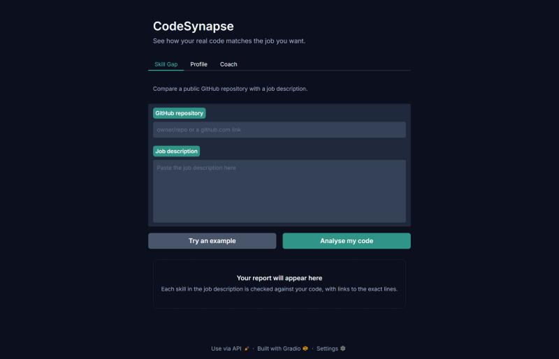
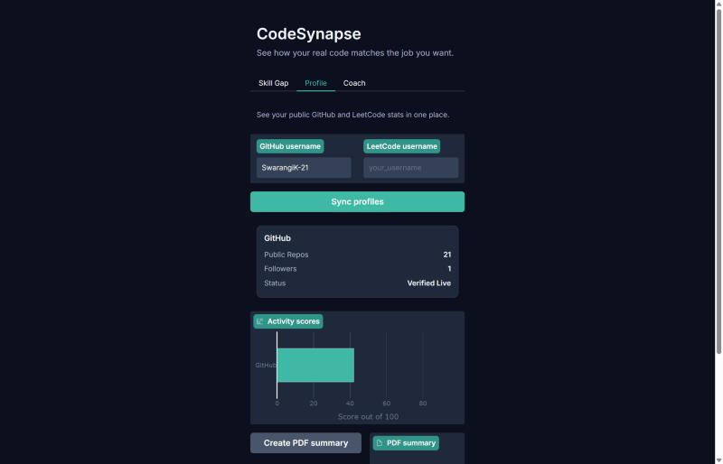
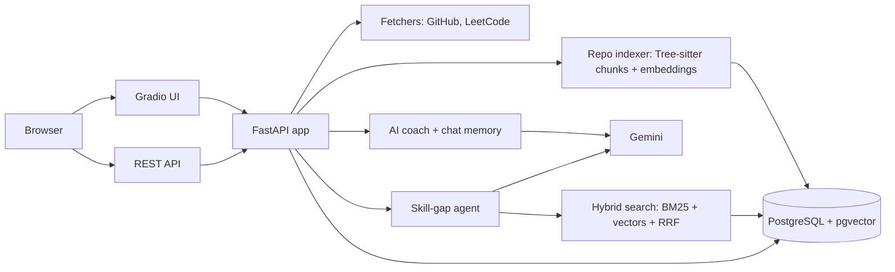
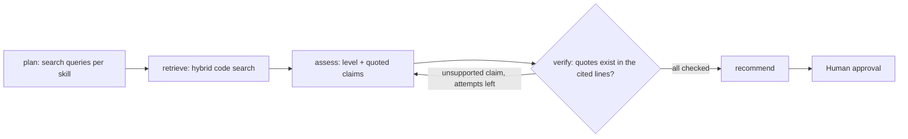

<h1 align="center">🧠 CodeSynapse — AI Career Architect</h1>

<p align="center"><b>Live coding analytics, an AI career coach, and a LangGraph skill-gap agent that proves every claim with line-level evidence from real repositories.</b></p>

<p align="center">
  <a href="https://github.com/SwarangiK-21/CodeSynapse/actions/workflows/ci.yml"></a>
  
  
  
  
  
  
  
</p>

| Skill-gap analysis | Live profile sync |
|:---:|:---:|
|  |  |

<sub>Screenshots from a local run of this repository (4 Nov 2026).</sub>

**Live demo:** [Hugging Face Space](https://huggingface.co/spaces/SwarangiK-21/CodeSynapse). It still runs the older January 2026 version, not the code in this repository.

---

## 📌 Problem statement

Students preparing for software roles get generic advice that ignores what they have actually built. Job descriptions list skills, but checking whether your own code demonstrates them is manual and subjective — and an LLM asked "does this repo show Kubernetes skills?" will happily say yes because of a comment or an unused import.

## 🎯 Objectives

1. Turn real, live GitHub and LeetCode statistics into comparable competency scores.
2. Give coaching that is grounded in those numbers, not invented ones.
3. Compare a repository with a job description and **cite the exact lines** that prove each skill — rejecting any claim that the source code does not support.
4. Measure the agent honestly: accuracy, citation validity and resistance to prompt injection.

---

## ✨ Key features

- **Live profile sync** — fetches public GitHub and LeetCode stats concurrently; if a user doesn't exist or a service is down, the app says so instead of showing made-up numbers.
- **Competency scores** — each platform's stats become a 0–100 score in an interactive Plotly chart.
- **AI career coach** — a Gemini chatbot that sees your synced stats and your last 10 messages, with structured replies and automatic fallback to another model.
- **Skill-gap agent** — a LangGraph workflow (`plan → retrieve → assess → verify → recommend`) compares repositories with a job description. A deterministic verifier checks every quoted claim against the real source, links it to exact lines, and retries or drops unsupported claims; a person approves the report before it is final.
- **Hybrid code search** — indexes public repositories by function and class with Tree-sitter, then retrieves with BM25 + vector search merged by reciprocal rank fusion. Repository code is read, never executed.
- **Job-description parsing** — extracts required skills and drops any skill the model cannot back with a quote from the text.
- **Private per-user data, PDF report and REST API** — everything in the UI is also available through FastAPI.

---

## 🛠️ Technology stack

| Layer | Tools |
|---|---|
| Backend | Python 3.14, FastAPI, Uvicorn |
| Frontend | Gradio, Plotly Express, Pandas |
| AI | Google Gemini via `google-genai`, LangGraph, Pydantic structured output |
| Retrieval | Tree-sitter, BM25, pgvector, reciprocal rank fusion |
| Data fetching | HTTPX (GitHub REST API, LeetCode GraphQL) |
| Database | SQLAlchemy, Alembic, PostgreSQL + pgvector (SQLite for quick local runs) |
| Reports | ReportLab |
| Quality | pytest, respx, ruff, GitHub Actions (lint, tests against Postgres, Docker build) |

---

## 🏗️ Architecture



### Skill-gap agent



The verifier is plain Python, not another model call: a claim survives only if its quote is found in the cited file and line range at the indexed commit.

---

## 📊 Evaluation results

From [`evals/results/summary.json`](evals/results/summary.json): real open-source repositories at pinned commits (8 in the standard set, 5 in the hard set), hybrid keyword and vector search, one model (`gemini-3.5-flash-lite`) throughout. The baseline uses the same code search but makes a single prompt, with no planning, verification or retry.

| Set | System | Skill pairs | Precision | Recall | F1 | Citations real | LLM calls |
|---|---|---:|---:|---:|---:|---:|---:|
| Standard | Baseline | 46 | 1.00 | 1.00 | 1.00 | — (none given) | 8 |
| Standard | **Agent** | 46 | 1.00 | 1.00 | 1.00 | **72 / 72** | 63 |
| Hard | Baseline | 22 | 0.69 | 1.00 | 0.81 | — (none given) | 5 |
| Hard | **Agent** | 22 | **0.92** | 1.00 | **0.96** | **26 / 26** | 32 |

On the hard set's four "mentioned in the docs but not used in the code" traps, the baseline was fooled by all four and the agent by one. That one is debatable: `encode/databases` runs MySQL and PostgreSQL as container services in CI, which the agent counted as Docker use. An earlier hard-set run with keyword search only is kept in [`evals/results/archive`](evals/results/archive) (agent precision 0.91, baseline 0.67).

**Prompt injection:** 8 of 8 attacks blocked (comments addressed to the AI, fake evidence blocks, fake JSON output, unused imports, dead strings). See [`evals/injection.py`](evals/injection.py).

What this shows: on easy cases a single prompt is as accurate, but the agent is the only one that gives verifiable evidence; on harder cases the agent cuts false positives. The cost is about 6–8× more LLM calls. The sets are small, so treat the numbers as indicative.

Reproduce: `python -m evals.run agent`, `baseline`, `agent-hard`, `baseline-hard`, `injection`, then `python -m evals.run report`.

---

## 🔧 Running locally

Requires Python 3.14 and a [Gemini API key](https://aistudio.google.com/apikey).

```bash
git clone https://github.com/SwarangiK-21/CodeSynapse.git
cd CodeSynapse
py -3.14 -m venv venv                         # macOS/Linux: python3.14 -m venv venv
venv/Scripts/python.exe -m pip install -r requirements-dev.txt
cp .env.example .env                          # then add GEMINI_API_KEY
venv/Scripts/python.exe app.py
```

The app runs at `http://localhost:7860`; API docs are at `http://localhost:7860/docs`. Without `DATABASE_URL` it uses a local SQLite file. On macOS/Linux use `venv/bin/python`.

Checks:

```bash
venv/Scripts/python.exe -m pytest
venv/Scripts/python.exe -m ruff check .
```

### With Docker

Set `DATABASE_URL` to a Postgres database and `UI_SECRET` to a long random value in `.env`, then:

```bash
docker build -t codesynapse .
docker run --env-file .env -p 7860:7860 codesynapse
```

---

## 🔌 API

Create a user with `POST /api/users`, then send the returned token as `Authorization: Bearer <token>`.

| Method | Path | Purpose |
|---|---|---|
| POST | `/api/users` | Create a user and get a token |
| GET, PUT | `/api/profile` | Read the profile, or sync it from live stats |
| GET, POST, DELETE | `/api/chat` | Read history, ask the coach, or clear history |
| GET | `/api/report` | Download the PDF report |
| GET, POST | `/api/repos` | List repositories, or index a public one |
| DELETE | `/api/repos/{id}` | Remove an indexed repository |
| GET | `/api/search?q=` | Search indexed code by keyword and meaning |
| POST | `/api/jobs` | Extract skills from a job description |
| GET | `/api/jobs/{id}` | Read a parsed job description |
| POST | `/api/analyses` | Start a skill-gap analysis |
| GET | `/api/analyses/{id}` | Read status, report, step trace and token usage |
| POST | `/api/analyses/{id}/approve` | Approve a draft report |
| GET | `/api/analyses/{id}/markdown` | Export a report as Markdown |
| GET | `/health` | Health check |

---

## 🗂️ Project structure

```
CodeSynapse/
├── app.py                    # Entry point: runs migrations, starts the server
├── codesynapse/
│   ├── main.py               # FastAPI app with the Gradio UI mounted
│   ├── config.py             # Settings from environment variables
│   ├── agents/               # LangGraph skill-gap agent + deterministic verifier
│   ├── api/routes.py         # REST endpoints
│   ├── services/             # Fetchers, coach, chat, chunker, embeddings, search, repos, jobs, reports
│   ├── ui/                   # Gradio interface, components and styling
│   └── db/                   # Models, session and migration runner
├── evals/                    # Benchmark cases, runner, metrics, injection attacks, saved results
├── docs/images/               # Screenshots
├── migrations/               # Alembic migrations
├── scripts/check_models.py   # Lists Gemini models your key can use
├── tests/                    # pytest suite; external services are mocked
└── .github/workflows/ci.yml  # Lint, tests (Postgres + pgvector) and Docker build
```

---

## 💼 Use cases

- A student checks which skills from a target job description their repositories already prove — with links to the lines.
- A mentor reviews a student's live coding stats and asks the coach for a focused 4-week plan.
- Recruiters or reviewers search a candidate's public code by concept ("JWT validation", "retry with backoff").

## ⚠️ Limitations

- The live Hugging Face demo still runs the January 2026 version.
- Evaluation sets are small (5 repositories each); results are indicative, not statistically strong.
- Only public repositories are indexed; GitHub and Gemini rate limits apply (set `GITHUB_TOKEN` for higher GitHub limits).
- Users are anonymous per browser; there is no GitHub login or rate limiting yet.

## 🗺️ Roadmap

- [x] Live GitHub and LeetCode stats
- [x] AI coach with stats context, conversation memory and model fallback
- [x] Per-user data on PostgreSQL with migrations
- [x] REST API, automated tests and CI
- [x] Index public repositories and search code with hybrid retrieval
- [x] Extract skills from job descriptions, each backed by a quote
- [x] Multi-step agent with cited, verified evidence
- [x] Evaluation suite with measured accuracy and prompt-injection tests
- [ ] Larger evaluation sets
- [ ] GitHub login, rate limiting and an updated live deployment

## 🤝 Contributing

Issues and pull requests are welcome. Run `ruff check .` and `pytest` before opening a PR, and never commit `.env` or API keys.

---

<p align="center">Built by <a href="https://github.com/SwarangiK-21">Swarangi Kothawade</a> · <a href="https://www.linkedin.com/in/swarangikothawade/">LinkedIn</a></p>
