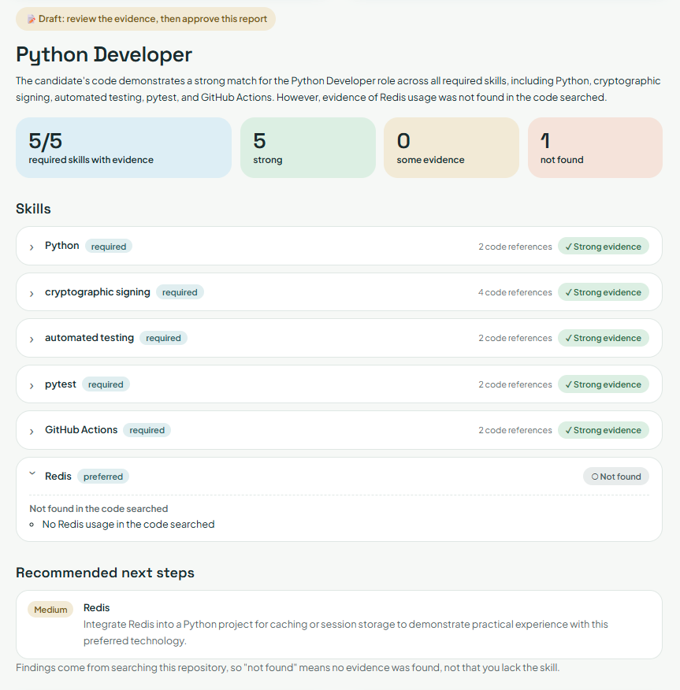
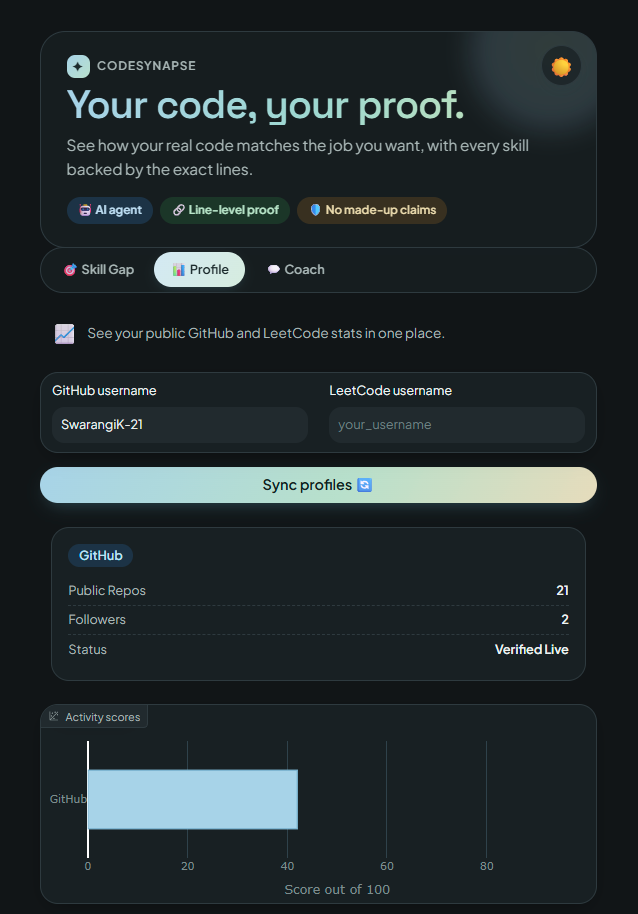
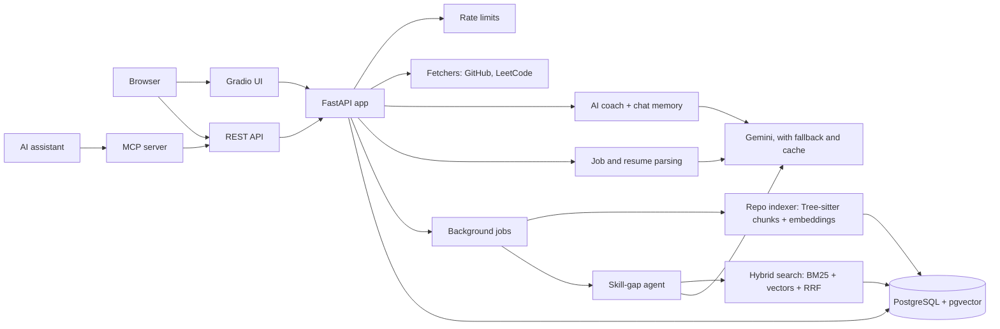
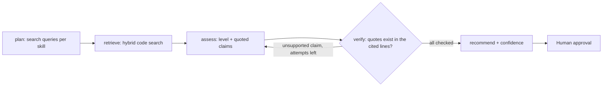

<h1 align="center">🧠 CodeSynapse — AI Career Architect</h1>

<p align="center"><b>A LangGraph agent that checks your real code against a job description or your own resume, and proves every claim with line-level evidence. Plus live coding analytics, an AI career coach, and an MCP server for AI assistants.</b></p>

<p align="center">
  <a href="https://github.com/SwarangiK-21/CodeSynapse/actions/workflows/ci.yml"></a>
  
  
  
  
  
  
  
  
  <a href="https://huggingface.co/spaces/SwarangiK-21/CodeSynapse"></a>
</p>

| Skill-gap analysis | Live profile sync |
|:---:|:---:|
|  |  |

<sub>Screenshots from the live demo (16 Nov 2026): a real analysis of <code>pallets/itsdangerous</code> in light mode, and the Profile tab in dark mode.</sub>

**Live demo:** [Hugging Face Space](https://huggingface.co/spaces/SwarangiK-21/CodeSynapse), deployed from `main` after CI passes, with data in Supabase Postgres ([how it deploys](docs/DEPLOY.md)). The free Space sleeps when idle, so the first visit can take a minute.

---

## 📌 Problem statement

Students preparing for software roles get generic advice that ignores what they have actually built. Job descriptions list skills and resumes list claims, but checking whether your own code demonstrates them is manual and subjective — and an LLM asked "does this repo show Kubernetes skills?" will happily say yes because of a comment or an unused import.

## 🎯 Objectives

1. Compare repositories with a job description, or with the claims on a resume, and **cite the exact lines** that prove each skill — rejecting any claim the source code does not support.
2. Measure the system honestly: accuracy against a baseline, citation validity, search quality, resistance to prompt injection, and whether its confidence can be trusted.
3. Turn real, live GitHub and LeetCode statistics into comparable competency scores, and give coaching grounded in those numbers, not invented ones.
4. Run it like a real service: background jobs, rate limits, caching, a deployed demo, and an MCP server so AI assistants can use it.

---

## ✨ Key features

**Evidence-checked analysis**

- **Skill-gap agent** — a LangGraph workflow (`plan → retrieve → assess → verify → recommend`) compares repositories with a job description. A deterministic verifier checks every quoted claim against the real source, links it to exact lines, and retries or drops unsupported claims; a person approves the report before it is final.
- **Resume claim checker** — upload a resume PDF (or paste it) and the same agent checks each technical claim against up to three repositories: backed by code, partly backed, or not found, with links to the lines. Only the extracted claims are stored, never the full resume or contact details.
- **Confidence estimates** — each skill can show a calibrated "% likely present", from a small logistic regression over facts the verifier has checked. The model, metrics and evaluation are built; its training data is still being collected (see Limitations below).
- **Hybrid code search** — indexes public repositories by function and class with Tree-sitter, then retrieves with BM25 + vector search merged by reciprocal rank fusion. Repository code is read, never executed.
- **Quote-backed parsing** — skills from a job description and claims from a resume are kept only when the model quotes them word for word from the text.

**For people and for AI assistants**

- **Four-tab web app** — Skill Gap, Resume Check, Profile and Coach, with a pastel light and dark theme that remembers your choice.
- **MCP server** — six tools that let AI assistants such as Claude or Cursor index repositories, search code and run skill and resume checks in conversation, with every result linked to the exact lines.
- **Live profile sync and scores** — fetches public GitHub and LeetCode stats; each becomes a 0–100 score in a Plotly chart. If a user doesn't exist or a service is down, the app says so instead of inventing numbers.
- **AI career coach** — a Gemini chatbot that sees your synced stats and your last 10 messages, with structured replies.
- **REST API, PDF and Markdown reports** — everything in the UI is also available through FastAPI, with private per-user data.

**Built to run as a service**

- **Background jobs** — indexing and analysis run outside the web request; jobs interrupted by a restart are marked failed, never left stuck.
- **Rate limits and caching** — per-user hourly limits protect the AI quota, and identical AI requests and embeddings are answered from a database cache.
- **Model fallback that learns** — if a Gemini model times out or is overloaded, requests move to the next one, and the struggling model rests at the back of the line for 5 minutes instead of slowing every later call.
- **Continuous deployment** — every push to `main` that passes CI is published to the live Space, which signs in to Hugging Face as a trusted publisher with no stored token.

---

## 🛠️ Technology stack

| Layer | Tools |
|---|---|
| Backend | Python 3.14, FastAPI, Uvicorn |
| Frontend | Gradio (custom theme, light and dark), Plotly Express, Pandas |
| AI | Google Gemini via `google-genai`, LangGraph, Pydantic structured output |
| Retrieval | Tree-sitter, BM25, pgvector, reciprocal rank fusion |
| Evaluation and ML | NumPy (calibration metrics, logistic regression), custom ranking metrics |
| Data and documents | HTTPX (GitHub REST API, LeetCode GraphQL), pypdf (resumes), ReportLab (PDF reports) |
| Database | SQLAlchemy, Alembic, PostgreSQL + pgvector (SQLite for quick local runs) |
| AI assistants | Model Context Protocol (`mcp` Python SDK) |
| Hosting | Docker on Hugging Face Spaces, Supabase Postgres with row-level security |
| Quality | pytest, respx, ruff, GitHub Actions (lint, tests against Postgres, Docker build, deploy, on-demand evals) |

---

## 🏗️ Architecture



The MCP server runs on the assistant's machine and calls the REST API, so it works with the live demo or any self-hosted copy.

### Skill-gap agent



The verifier is plain Python, not another model call: a claim survives only if its quote is found in the cited file and line range at the indexed commit, and a quote that is only an import line never counts. The same graph checks resumes: each claim becomes a "skill" whose quote comes from the resume, and the prompts say "the resume claims" instead of "the job asks for".

---

## 📊 Evaluation results

From [`evals/results/summary.json`](evals/results/summary.json): real open-source repositories at pinned commits (8 in the standard set, 5 in the hard set), hybrid keyword and vector search, one model (`gemini-3.5-flash-lite`) throughout. The baseline uses the same code search but makes a single prompt, with no planning, verification or retry.

| Set | System | Skill pairs | Precision | Recall | F1 | Citations real | LLM calls |
|---|---|---:|---:|---:|---:|---:|---:|
| Standard | Baseline | 46 | 1.00 | 1.00 | 1.00 | — (none given) | 8 |
| Standard | **Agent** | 46 | 1.00 | 1.00 | 1.00 | **72 / 72** | 63 |
| Hard | Baseline | 22 | 0.69 | 1.00 | 0.81 | — (none given) | 5 |
| Hard | **Agent** | 22 | **0.92** | 1.00 | **0.96** | **26 / 26** | 32 |

On the hard set's four "mentioned in the docs but not used in the code" traps, the baseline was fooled by all four and the agent by one. That one is debatable: `encode/databases` runs MySQL and PostgreSQL as container services in CI, which the agent counted as Docker use. An earlier hard-set run with keyword search only is kept in [`evals/results/archive`](evals/results/archive) (agent precision 0.91, baseline 0.67).

**Prompt injection:** 8 of 8 attacks blocked (comments addressed to the AI, fake evidence blocks, fake JSON output, unused imports, dead strings). See [`evals/injection.py`](evals/injection.py).

What this shows: on easy cases a single prompt is as accurate, but the agent is the only one that gives verifiable evidence; on harder cases the agent cuts false positives. The cost is about 6–8× more LLM calls. The sets are small, so treat the numbers as indicative.

Reproduce: `python -m evals.run agent`, `baseline`, `agent-hard`, `baseline-hard`, `injection`, then `python -m evals.run report`.

### Code search quality

From [`evals/results/retrieval.json`](evals/results/retrieval.json): can search find real evidence for a skill? The queries are the 37 skills labelled present across both sets. A code chunk counts as relevant when it contains that skill's proof, the same pattern [`check_labels.py`](evals/check_labels.py) verifies against the real files, so the labels need no AI. Success@k: a relevant chunk is in the top k. MRR: how high the first one ranks.

| Method | Success@1 | Success@5 | MRR@10 | Paraphrased skills (10): Success@1 / MRR |
|---|---:|---:|---:|---:|
| Keyword (BM25) | 0.30 | 0.59 | 0.40 | 0.20 / 0.30 |
| Vector | 0.41 | **0.84** | 0.57 | 0.30 / **0.53** |
| Hybrid, equal weights (in use) | 0.30 | 0.70 | 0.47 | 0.00 / 0.29 |
| **Hybrid, tuned** | **0.49** | 0.81 | **0.61** | 0.30 / 0.51 |

The equal-weight hybrid the app uses scored *below* vector search alone: on paraphrased skills its first result was never relevant, because weak keyword matches pushed good vector matches down. Giving keywords a quarter of the weight with a sharper fusion curve (RRF k=10) fixed that. The setting was tuned on the standard set only and held up on the paraphrased hard queries it never saw. The app keeps equal weights until the agent is re-evaluated with the tuned search. With 37 queries these numbers are indicative.

Reproduce: `python -m evals.retrieval` (reuses the evaluation index; query vectors are cached).

### Confidence calibration (in progress)

Can the agent's confidence be trusted? [`evals/calibration.py`](evals/calibration.py) records, for every labelled skill, the verified level, the citations that held up, any rejected claims, and the model's own stated confidence. It then compares four ways of turning that into a probability (the model's raw confidence, the verified level alone, the confidence rescaled, and a logistic regression on all of it) by **leave-one-repository-out cross-validation**, scoring calibration error (ECE), Brier score and AUROC, with a reliability chart. The best model is what the app shows as "% likely present".

Status: 29 of 68 records collected. The rest wait on the free Gemini embedding quota, and results will be published here once collection finishes. Records are collected by the hand-started **Evals** workflow in GitHub Actions (`python -m evals.calibration collect`), and scored with `python -m evals.calibration analyze`, which needs no AI.

---

## 🔧 Running locally

Requires Python 3.14 and a [Gemini API key](https://aistudio.google.com/apikey).

```bash
git clone https://github.com/SwarangiK-21/CodeSynapse.git
cd CodeSynapse
py -3.14 -m venv venv                         # macOS/Linux: python3.14 -m venv venv
venv/Scripts/python.exe -m pip install -r requirements-dev.txt
cp .env.example .env                          # then add GEMINI_API_KEY
venv/Scripts/python.exe app.py
```

The app runs at `http://localhost:7860`; API docs are at `http://localhost:7860/docs`. Without `DATABASE_URL` it uses a local SQLite file. On macOS/Linux use `venv/bin/python`. `requirements-dev.txt` includes the test tools and the MCP server's dependencies.

Optional settings in `.env`:

| Variable | Purpose |
|---|---|
| `DATABASE_URL` | PostgreSQL with pgvector; plain `postgresql://` URLs, as Supabase gives them, work as-is |
| `GITHUB_TOKEN` | Raises GitHub's rate limit for downloading repositories |
| `GEMINI_MODELS` | Comma-separated models to try in order |
| `UI_SECRET` | Encrypts the browser's copy of the user token; required when deployed |
| `WORKERS` | How many indexing and analysis jobs run at once (default 2) |

Checks:

```bash
venv/Scripts/python.exe -m pytest
venv/Scripts/python.exe -m ruff check .
```

### With Docker

Set `DATABASE_URL` to a Postgres database and `UI_SECRET` to a long random value in `.env`, then:

```bash
docker build -t codesynapse .
docker run --env-file .env -p 7860:7860 codesynapse
```

### Deploying your own copy

The live demo runs on a Hugging Face Space (Docker) with Supabase Postgres. [`docs/DEPLOY.md`](docs/DEPLOY.md) covers the database, the Space secrets and the trusted-publisher setup that lets GitHub Actions deploy without a stored token.

---

## 🤖 Use it from an AI assistant (MCP)

[`codesynapse/mcp_server.py`](codesynapse/mcp_server.py) is a [Model Context Protocol](https://modelcontextprotocol.io) server, so Claude Desktop, Claude Code, Cursor or any MCP client can use CodeSynapse in conversation: *"index my repo and check it against this job post"*, *"which claims on my resume does my code back up?"*.

| Tool | What it does |
|---|---|
| `index_repository` | Adds a public GitHub repository and waits until it is searchable |
| `list_repositories` | Lists your indexed repositories |
| `search_code` | Searches by keywords and meaning; every result links to the exact lines |
| `start_skill_check` | Starts checking repositories against a job description |
| `start_resume_check` | Starts checking each claim on a resume against repositories |
| `get_report` | Returns progress, or the finished report with its evidence links |

Analyses take minutes, longer than assistants wait for one call, so they are started by one tool and collected with `get_report`. The server talks to the live demo by default; set `CODESYNAPSE_URL` to use your own. On first use it creates a private user and keeps the token in `~/.codesynapse/token`.

```bash
pip install -r requirements-mcp.txt
```

**Claude Code:**

```bash
claude mcp add codesynapse -- python /path/to/CodeSynapse/codesynapse/mcp_server.py
```

**Claude Desktop** (`claude_desktop_config.json`):

```json
{
  "mcpServers": {
    "codesynapse": {
      "command": "python",
      "args": ["/path/to/CodeSynapse/codesynapse/mcp_server.py"]
    }
  }
}
```

---

## 🔌 API

Create a user with `POST /api/users`, then send the returned token as `Authorization: Bearer <token>`. Expensive actions are limited per user each hour (5 analyses, 10 repositories, 20 job descriptions or resumes, 40 coach messages); over the limit the API returns `429` with a `Retry-After` header. Indexing and analysis return `202` at once and finish in the background, so poll their status.

| Method | Path | Purpose |
|---|---|---|
| POST | `/api/users` | Create a user and get a token |
| GET, PUT | `/api/profile` | Read the profile, or sync it from live stats |
| GET, POST, DELETE | `/api/chat` | Read history, ask the coach, or clear history |
| GET | `/api/report` | Download the PDF report |
| GET, POST | `/api/repos` | List repositories with their status, or start indexing a public one in the background |
| DELETE | `/api/repos/{id}` | Remove an indexed repository |
| GET | `/api/search?q=` | Search indexed code by keyword and meaning |
| POST | `/api/jobs` | Extract skills from a job description |
| GET | `/api/jobs/{id}` | Read a parsed job description |
| POST | `/api/resumes` | Read a resume (PDF upload or `text` form field) and extract its claims; pass the returned id as `job_id` to `/api/analyses` |
| POST | `/api/analyses` | Start a skill-gap analysis |
| GET | `/api/analyses/{id}` | Read status, report, step trace and token usage |
| POST | `/api/analyses/{id}/approve` | Approve a draft report |
| GET | `/api/analyses/{id}/markdown` | Export a report as Markdown |
| GET | `/health` | Health check |

---

## 🗂️ Project structure

```
CodeSynapse/
├── app.py                     # Entry point: runs migrations, recovers interrupted jobs, starts the server
├── codesynapse/
│   ├── main.py                # FastAPI app with the Gradio UI mounted
│   ├── config.py              # Settings from environment variables
│   ├── mcp_server.py          # MCP server for AI assistants (talks to the REST API)
│   ├── agents/                # LangGraph agent, deterministic verifier, confidence model
│   ├── api/routes.py          # REST endpoints
│   ├── services/              # Search, indexing, job and resume parsing, analyses, background jobs,
│   │                          # rate limits, cache, Gemini calls and model fallback, coach, reports
│   ├── ui/                    # Gradio interface, report components and theme
│   └── db/                    # Models, session and migration runner
├── evals/                     # Benchmark cases, agent/baseline runner, retrieval and calibration
│                              # evaluations, injection attacks, metrics, saved results
├── migrations/                # Alembic migrations
├── deploy/push_space.py       # Uploads the app to the Hugging Face Space
├── docs/                      # Deployment guide and screenshots
├── scripts/check_models.py    # Lists Gemini models your key can use
├── tests/                     # pytest suite; external services are mocked
├── requirements-mcp.txt       # Extra dependencies for the MCP server only
└── .github/workflows/         # ci.yml (lint, tests, Docker build), deploy.yml, evals.yml
```

---

## 💼 Use cases

- A student checks which skills from a target job description their repositories already prove — with links to the lines.
- A student checks their resume before applying: which claims are backed by public code, and what to build for the rest.
- Someone asks their AI assistant, through the MCP server, to search their projects or check them against a job post, without leaving the chat.
- A mentor reviews a student's live coding stats and asks the coach for a focused 4-week plan.
- Recruiters or reviewers search a candidate's public code by concept ("JWT validation", "retry with backoff").

## ⚠️ Limitations

- Evaluation sets are small (standard: 8 repositories, 46 skill pairs; hard: 5 repositories, 22 pairs), so results are indicative, not statistically strong.
- Confidence calibration has 29 of 68 records so far, so reports show no "% likely" value until its model is trained.
- The tuned search setting measured above isn't switched on yet: the agent's published scores used the equal-weight hybrid, and switching needs a re-run first.
- The live demo runs on free tiers: the Space sleeps when idle, Gemini's daily embedding quota limits how much new code can be indexed in a day, and an overloaded Gemini model can make an analysis slow.
- Only public repositories are indexed; GitHub and Gemini rate limits apply (set `GITHUB_TOKEN` for higher GitHub limits). Scanned-image resumes need their text pasted.
- "Not found" means no evidence was found in the code searched, not that the person lacks the skill or that a resume claim is false.
- Users are anonymous per browser; there is no GitHub login yet.
- Background jobs, rate limits and model fallback live in one process, which suits a single server. Several servers would need a shared queue and store such as Redis.

## 🗺️ Roadmap

- [x] Live GitHub and LeetCode stats
- [x] AI coach with stats context, conversation memory and model fallback
- [x] Per-user data on PostgreSQL with migrations
- [x] REST API, automated tests and CI
- [x] Index public repositories and search code with hybrid retrieval
- [x] Extract skills from job descriptions, each backed by a quote
- [x] Multi-step agent with cited, verified evidence
- [x] Evaluation suite with measured accuracy and prompt-injection tests
- [x] Background indexing and analysis, rate limiting, and caching of AI results
- [x] Live deployment on Hugging Face with Supabase, deployed automatically from CI
- [x] Redesigned interface with light and dark themes
- [x] Retrieval evaluation (Success@k, MRR, nDCG) and tuned hybrid search
- [x] Resume claim checker
- [x] MCP server for AI assistants
- [ ] Calibrated confidence: finish collecting records, train and publish
- [ ] Switch the app to the tuned search after re-running the agent evaluation
- [ ] Fine-tuned reranker distilled from Gemini's relevance judgements
- [ ] Larger evaluation sets
- [ ] GitHub login

## 🤝 Contributing

Issues and pull requests are welcome. Run `ruff check .` and `pytest` before opening a PR, and never commit `.env` or API keys.

---

<p align="center">Built by <a href="https://github.com/SwarangiK-21">Swarangi Kothawade</a> · <a href="https://www.linkedin.com/in/swarangikothawade/">LinkedIn</a></p>
